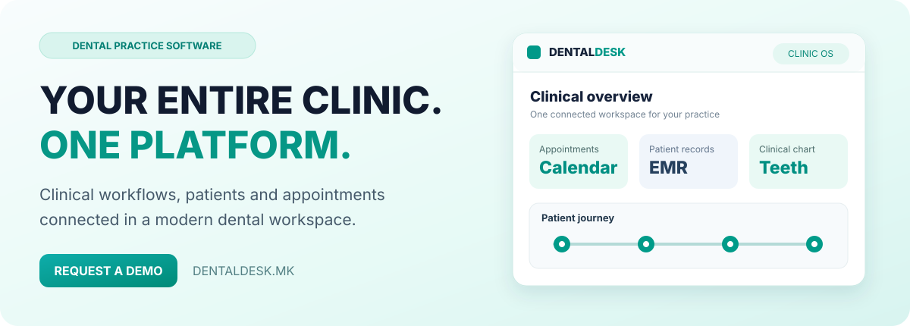

[Македонски](README.mk.md) · [English](README.md) · [Shqip](README.sq.md) · [Türkçe](README.tr.md)

  

 

### The complete dental practice. One connected platform.

**Digital Patient Records · Odontogram and Tooth Context · Appointments and Calendar · Treatment Planning and Visits · Clinical Documents and Findings**

[Македонски](README.mk.md) · [PROCESS IN Portfolio](https://github.com/stambolce/process-in)

---

## Software built around the actual work of a dental practice

**[DentalDesk](https://dentaldesk.mk)** is a dental practice management saas developed by **[PROCESS IN](https://processin.mk)**. DentalDesk connects patient records, clinical examination, dental charting, appointments, treatment documentation, clinic operations and a clinic-branded patient website in one platform. It is developed by PROCESS IN for dental practices that want clinical workflows—not just a calendar or a contact database.

Rather than treating patient care, scheduling, records and administration as unrelated tasks, DentalDesk brings them together as a connected practice workflow. The result is a clearer operational environment for the people providing care and the teams supporting them.

## From the first appointment to ongoing care

| Stage | What happens |
|---|---|
| **01 — Appointment and patient intake** | Organize appointments and connect the visit with the correct patient profile. |
| **02 — Patient history and examination** | Review dental history and document relevant clinical findings. |
| **03 — Odontogram and treatment context** | Work with tooth-oriented records and clinical treatment information. |
| **04 — Treatment and documentation** | Keep the visit, planned care and related records together. |
| **05 — Practice administration** | Coordinate invoices, reporting and daily clinic operations. |
| **06 — Patient communication and follow-up** | Maintain contact through clinic-facing workflows and the patient website. |

## One connected clinical and operational workspace

<table><tr><td width="50%" valign="top">

### ◈ Digital Patient Records
Structured patient profiles, history and visit information for consistent dental documentation.

### ◆ Appointments and Calendar
Scheduling and daily appointment visibility for dentists and practice teams.

### ◉ Clinical Documents and Findings
Keep documentation and treatment-related information accessible in the patient context.

### ◇ Clinic-Branded Responsive Website
Each subscribed clinic receives its own representative patient-facing website within the product offering.

### ✦ Specialist Workflow Modules
An extensible clinical direction for imaging, laboratory coordination and specialized treatment areas.

</td><td width="50%" valign="top">

### ▣ Odontogram and Tooth Context
Tooth-oriented clinical information that supports dental charting and treatment discussions.

### ◎ Treatment Planning and Visits
A connected workflow between examination, clinical findings, treatment and follow-up.

### ▤ Practice Billing and Reporting
Administrative and financial workflows supporting clinic operations.

### ▦ Patient-Facing Communication
Website-linked patient messages, findings transfer and tooth-related information where available in the package.

### ▧ Teams and Localization
Clinic staff workflows with Macedonian, English and Albanian localization scope.

</td></tr></table>

### A website for every subscribed clinic

DentalDesk includes a **clinic-branded, responsive website with every plan**. This extends the product beyond internal practice administration into patient-facing presentation and communication. Available messaging, findings transfer and tooth-view features depend on the subscribed package.

## Who uses DentalDesk?

- **Independent dental offices:** A connected workflow with the clinical and operational context relevant to this audience.
- **Dental clinics and specialist practices:** A connected workflow with the clinical and operational context relevant to this audience.
- **Dentists, assistants and administrative teams:** A connected workflow with the clinical and operational context relevant to this audience.
- **Practices seeking an integrated patient website:** A connected workflow with the clinical and operational context relevant to this audience.

## Why an integrated practice platform matters

| Fragmented approach | DentalDesk approach |
|---|---|
| Separate scheduling and clinical notes | Appointment and patient context in one workflow |
| Disconnected patient information | Organized history and visit documentation |
| Administrative work outside clinical context | Connected operational modules and reporting |
| Inconsistent communication | Clear patient or owner-facing contact workflows |
| Generic tools with no clinical focus | Product structure designed for the practice's daily work |

## Industry terminology and product discovery

DentalDesk serves needs often searched for as **dental practice management software**, **dental clinic management system**, **electronic dental records**, **odontogram software**, **dental appointment scheduling**, **dental patient portal**, **dental clinic website**, **dental treatment planning**, **dental billing software**. The terminology is included to clarify the scope of the product and help professionals compare relevant solutions; it does not imply that unrelated integrations or specific plan features are universally available.

## 🇲🇰 DentalDesk — Една платформа за секојдневната работа

DentalDesk е стоматолошка платформа на PROCESS IN која ги поврзува пациентите, клиничките прегледи, одонтограмот, термините, третманите, административните процеси и сопствената веб-страница на ординацијата.

**Клучната предност** е поврзување на клиничката и административната работа во еден прегледен систем. Од закажување до медицинска документација, третман, наплата и следна комуникација — секој чекор има свое место.

**Електронски картони.** Податоци за пациентот, историја и клинички записи во поврзана евиденција.

**Одонтограм.** Преглед и документирање стоматолошки информации поврзани со конкретни заби.

**Календар и термини.** Организација на закажувања и дневната работа на ординацијата.

**Прегледи и третмани.** Поврзување на клиничките наоди, планот и извршените третмани.

**Медицинска документација.** Евиденција на наоди и документи во контекст на пациентот.

**Фактурирање и извештаи.** Поддршка за административните и финансиските процеси.

[Прочитај ја целосната македонска презентација](README.mk.md).

---

## Product information

| | |
|---|---|
| **Product** | [DentalDesk](https://dentaldesk.mk) |
| **Developer** | [PROCESS IN](https://processin.mk) |
| **Category** | Dental practice management SaaS |
| **Audience** | Independent dental offices; Dental clinics and specialist practices; Dentists, assistants and administrative teams; Practices seeking an integrated patient website |
| **Core workflow** | Appointment → Patient → Odontogram → Treatment → Practice → Patient |
| **Official website** | https://dentaldesk.mk |
| **Request demo** | https://dentaldesk.mk/demo |
| **Plans and pricing** | https://dentaldesk.mk/pricing |
| **Company portfolio** | https://github.com/stambolce/process-in |

### The complete dental practice. One connected platform.

---

Official public DentalDesk product showcase maintained by PROCESS IN. This is not the proprietary application source code and does not grant an open-source license. Specific plan entitlements, localization and service terms follow the current official offering.
